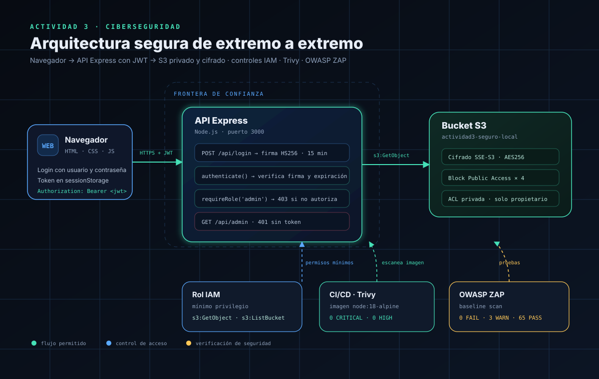

# Actividad 3 · Seguridad en la nube, contenedores y APIs


Laboratorio completo con tres fases: **infraestructura como código**, **seguridad de imágenes** y **API segura con JWT**.



## Resultados en 30 segundos

| Fase | Entregable | Resultado |
|---|---|---|
| 1 · AWS | Bucket S3 con Terraform + LocalStack | ✅ 3 recursos · AES-256 · 4/4 bloqueos públicos |
| 2 · Imágenes | `node:14` → `node:18-alpine` con Trivy | ✅ 595 hallazgos / 23 críticas → **0 / 0** |
| 3 · Sitio/API | Login JWT + endpoints protegidos + ZAP | ✅ `401` / `403` / `200` · **0 FAIL** en ZAP |

## Estructura

```
Act3/
├── fase1/                 # Terraform + LocalStack + S3
│   ├── compose.yaml
│   ├── providers.tf
│   ├── main.tf
│   └── evidencias/
├── fase2/                 # Docker + Trivy
│   ├── Dockerfile
│   ├── Dockerfile.vulnerable
│   └── evidencias/
├── fase3/                 # API + sitio + JWT + ZAP
│   ├── server.js
│   ├── public/
│   ├── iam-policy.json
│   └── evidencias/
├── docs/
│   ├── INFORME.md
│   ├── arquitectura.svg
│   ├── arquitectura.drawio
│   └── capturas/
└── README.md
```

## Inicio rápido

### Fase 1 · S3 seguro

```bash
cd fase1
cp .env.example .env        # pega tu token de LocalStack Hobby
docker compose up -d
terraform init
terraform plan -out=tfplan
terraform apply tfplan
```

### Fase 2 · Contenedores

```bash
cd fase2
docker build -f Dockerfile.vulnerable -t act3-app:node14 .
trivy image --severity CRITICAL,HIGH act3-app:node14

docker build -f Dockerfile -t act3-app:node18 .
trivy image --severity CRITICAL,HIGH act3-app:node18
```

### Fase 3 · Sitio + API

```bash
cd fase3
cp .env.example .env        # define un JWT_SECRET largo
npm install
npm start
# http://localhost:3000
```

Credenciales demo: `admin / admin123` · `usuario / usuario123`

## Evidencias destacadas

| Evidencia | Archivo |
|---|---|
| Terraform apply | [`fase1/evidencias/terraform-apply.txt`](fase1/evidencias/terraform-apply.txt) |
| Cifrado y bloqueo público | [`fase1/evidencias/verificacion-s3.txt`](fase1/evidencias/verificacion-s3.txt) |
| Trivy imagen vulnerable | [`fase2/evidencias/trivy-node14.txt`](fase2/evidencias/trivy-node14.txt) |
| Trivy imagen corregida | [`fase2/evidencias/trivy-node18.txt`](fase2/evidencias/trivy-node18.txt) |
| Pruebas 401/403/200 | [`fase3/evidencias/pruebas-autorizacion.txt`](fase3/evidencias/pruebas-autorizacion.txt) |
| Reporte ZAP | [`fase3/evidencias/zap-baseline.html`](fase3/evidencias/zap-baseline.html) |
| Capturas del sitio | [`docs/capturas/`](docs/capturas/) |

## Informe

- [Informe completo en Markdown](docs/INFORME.md)
- [Informe visual en PDF](docs/Informe_Actividad3.pdf)
- [Diagrama editable en draw.io](docs/arquitectura.drawio)

## Seguridad

- El token de LocalStack y el `JWT_SECRET` viven en `.env`, ignorado por Git.
- No se versionan `terraform.tfstate`, `.terraform/`, `tfplan` ni `node_modules/`.
- Las credenciales de AWS usadas por Terraform son ficticias (`test` / `test`) y solo apuntan a LocalStack.
- LocalStack es un simulador: el acceso anónimo puede diferir de AWS real y se documenta como limitación.
- ZAP se ejecutó únicamente contra la API local.
