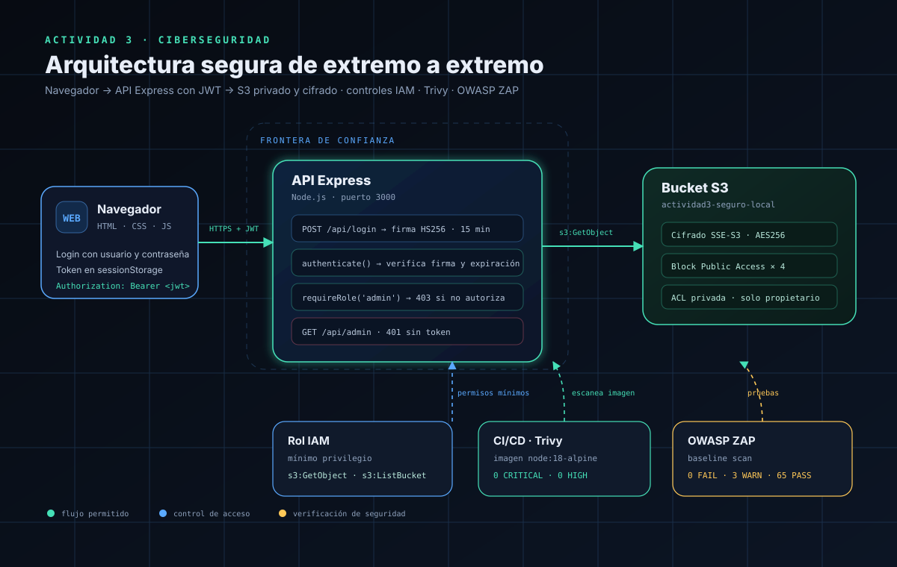
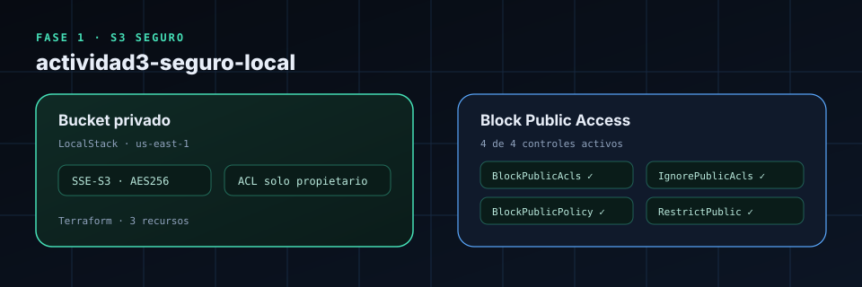
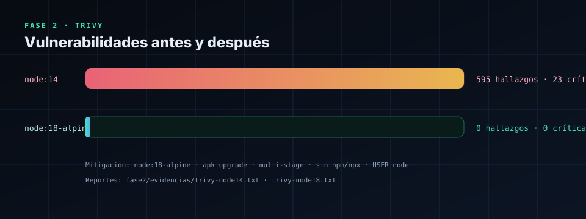
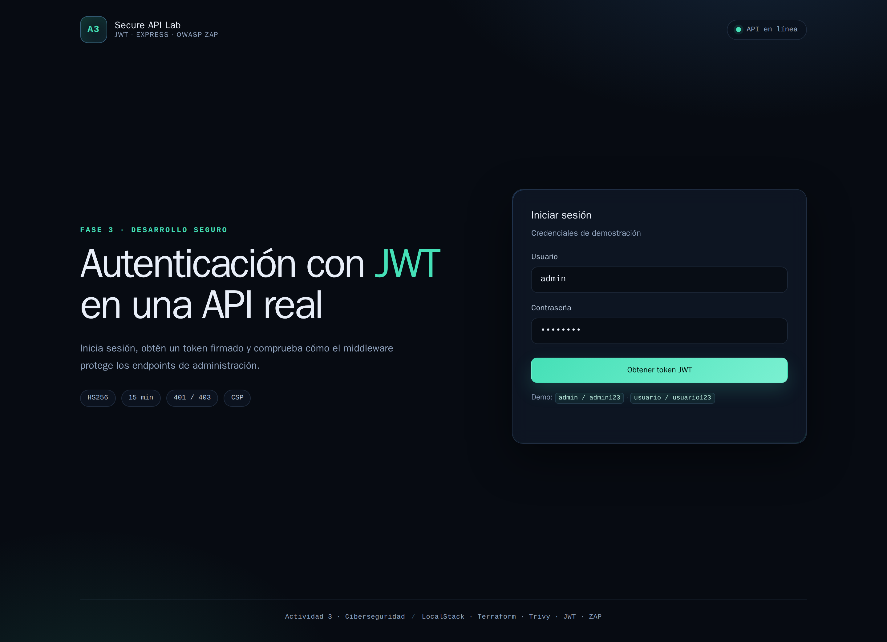
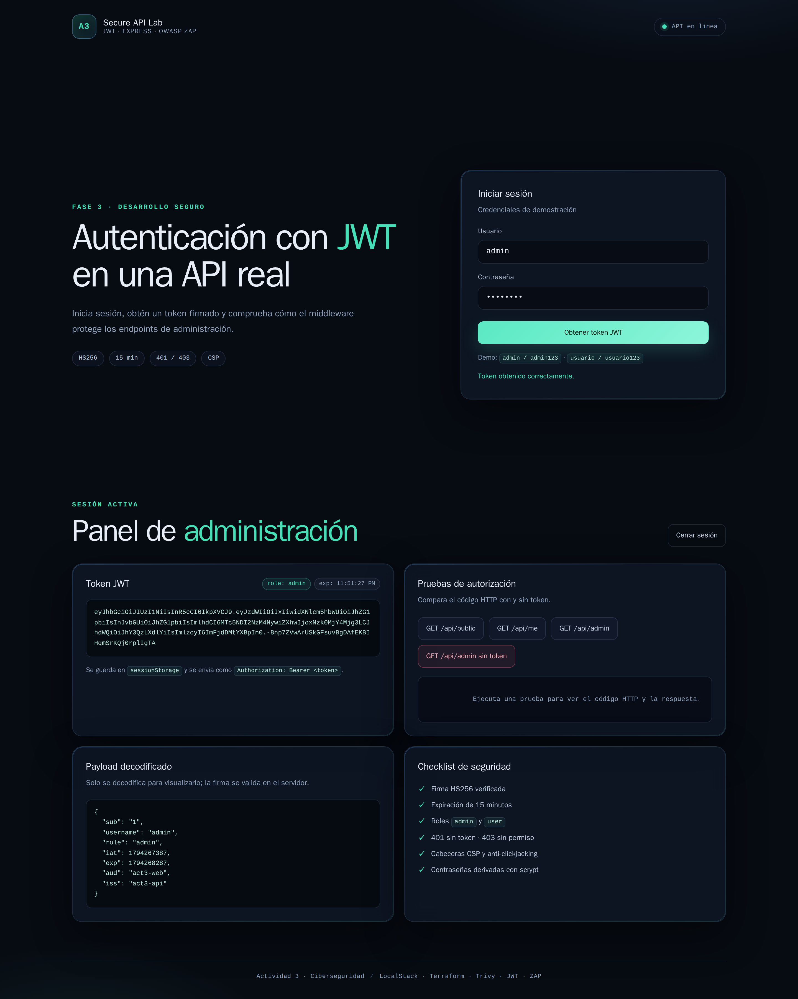
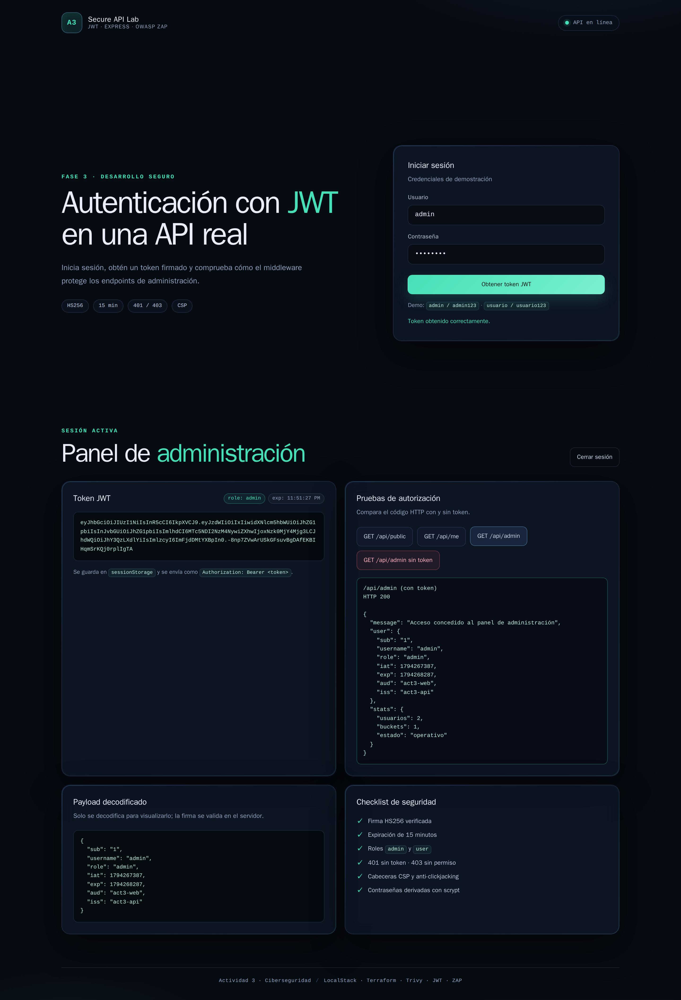

# Actividad 3 · Seguridad en la nube, contenedores y APIs

**Alumno:** Hugo Ruiz  
**Materia:** Ciberseguridad  
**Fecha:** noviembre de 2026

| Fase | Tema | Herramientas | Resultado clave |
|---|---|---|---|
| 1 | Infraestructura como código | Terraform · LocalStack · AWS CLI | Bucket privado, AES-256, 4/4 bloqueos públicos |
| 2 | Seguridad de contenedores | Docker · Trivy | 595 hallazgos → **0** |
| 3 | Desarrollo seguro y autenticación | Node.js · Express · JWT · OWASP ZAP | `401` / `403` / `200` · **0 FAIL** |

---

## 1. Arquitectura



**Flujo seguro:** el navegador inicia sesión, recibe un JWT firmado con HS256 y lo envía en `Authorization: Bearer`. La API valida firma, expiración y rol antes de permitir `/api/admin`. El bucket S3 permanece privado, cifrado y con los cuatro controles de bloqueo público. El rol IAM solo permite lectura del bucket. Trivy y ZAP verifican la imagen y la API.

---

## 2. Fase 1 · Bucket S3 seguro con Terraform + LocalStack

### Recursos declarados

| Recurso | Configuración |
|---|---|
| `aws_s3_bucket` | `actividad3-seguro-local` |
| `aws_s3_bucket_server_side_encryption_configuration` | `SSEAlgorithm = AES256` |
| `aws_s3_bucket_public_access_block` | 4 controles en `true` |

### Verificación real

| Consulta | Resultado |
|---|---|
| `terraform apply` | `3 added, 0 changed, 0 destroyed` |
| `get-bucket-encryption` | `"SSEAlgorithm": "AES256"` |
| `get-public-access-block` | `BlockPublicAcls`, `IgnorePublicAcls`, `BlockPublicPolicy`, `RestrictPublicBuckets` = `true` |
| `get-bucket-acl` | Solo propietario con `FULL_CONTROL` |
| `get-bucket-policy-status` | `NoSuchBucketPolicy` |
| Segundo `terraform plan` | `No changes` |



> **Lectura importante:** `NoSuchBucketPolicy` solo indica que no hay una política de bucket adjunta. No significa que el bucket sea público. La privacidad se sostiene con la ACL privada y los cuatro bloqueos.

### Acceso anónimo en LocalStack

```text
HTTP/1.1 200 OK
x-amz-server-side-encryption: AES256
```

LocalStack permitió la lectura anónima. Es una **limitación del simulador**: no replica todas las reglas de autorización de AWS. La respuesta confirma que el objeto está cifrado con AES-256. En AWS real, con los cuatro bloqueos activos y sin política pública, la lectura anónima se deniega.

**Evidencias:** [`fase1/evidencias/`](../fase1/evidencias/)

---

## 3. Fase 2 · Seguridad de contenedores con Docker + Trivy

### Antes y después

| Imagen | SO | Node/npm | Total | Críticas | Altas |
|---|---:|---:|---:|---:|---:|
| `act3-app:node14` | 566 | 29 | **595** | **23** | **572** |
| `act3-app:node18` | 0 | 0 | **0** | **0** | **0** |



### Mitigaciones aplicadas

| Medida | Efecto |
|---|---|
| `node:14` → `node:18-alpine` | Base más reciente y menor superficie |
| `apk upgrade --no-cache` | Corrige OpenSSL y zlib del sistema |
| Build multi-stage | Solo pasan a la imagen final las dependencias de producción |
| Eliminar `npm`, `npx` y `corepack` | Quita del runtime paquetes vulnerables que la app no necesita |
| `USER node` | La aplicación no corre como root |

### Dockerfile final

```dockerfile
FROM node:18-alpine AS deps
WORKDIR /app
COPY package*.json ./
RUN npm ci --omit=dev

FROM node:18-alpine
RUN apk upgrade --no-cache \
    && rm -rf /usr/local/lib/node_modules/npm \
              /usr/local/lib/node_modules/corepack \
              /usr/local/bin/npm /usr/local/bin/npx /usr/local/bin/corepack
WORKDIR /app
COPY --from=deps /app/node_modules ./node_modules
COPY package.json server.js ./
ENV NODE_ENV=production
USER node
CMD ["node", "server.js"]
```

**Evidencias:** [`fase2/evidencias/`](../fase2/evidencias/)

> **Nota:** la actividad pide `node:18`. A noviembre de 2026 Node 18 ya está fuera de soporte; para un proyecto real se recomienda `node:22-alpine` o superior.

---

## 4. Fase 3 · Sitio y API con autenticación JWT

### Sitio







### Matriz de autorización

| Prueba | Código | Resultado |
|---|---:|---|
| `GET /api/admin` sin token | `401` | ✅ |
| `GET /api/admin` con token inválido | `401` | ✅ |
| `GET /api/admin` con token de `usuario` | `403` | ✅ |
| `GET /api/admin` con token de `admin` | `200` | ✅ |

### Middleware JWT

```js
function authenticate(req, res, next) {
  const authHeader = req.headers.authorization;

  if (!authHeader || !authHeader.startsWith('Bearer ')) {
    return res.status(401).json({ error: 'Token requerido' });
  }

  const token = authHeader.slice(7).trim();

  try {
    req.user = jwt.verify(token, JWT_SECRET, {
      algorithms: ['HS256'],
      issuer: 'act3-api',
      audience: 'act3-web'
    });
    return next();
  } catch (error) {
    return res.status(401).json({ error: 'Token inválido o expirado' });
  }
}

function requireRole(role) {
  return (req, res, next) => {
    if (!req.user || req.user.role !== role) {
      return res.status(403).json({ error: 'Acceso denegado' });
    }
    return next();
  };
}
```

### OWASP ZAP

| Métrica | Valor |
|---|---:|
| FAIL | **0** |
| WARN | 3 |
| PASS | 65 |

Las 3 advertencias son de bajo riesgo: contenido no almacenable, formulario de login detectado (esperado) y ausencia de token anti-CSRF. La API usa JSON + `Authorization: Bearer`, por lo que el riesgo CSRF es bajo. Se documenta como mejora.

### Política IAM de mínimo privilegio

```json
{
  "Version": "2012-10-17",
  "Statement": [
    {
      "Sid": "LeerObjetosDelBucket",
      "Effect": "Allow",
      "Action": ["s3:GetObject"],
      "Resource": "arn:aws:s3:::actividad3-seguro-local/*"
    },
    {
      "Sid": "ListarSoloEseBucket",
      "Effect": "Allow",
      "Action": ["s3:ListBucket"],
      "Resource": "arn:aws:s3:::actividad3-seguro-local"
    }
  ]
}
```

**Evidencias:** [`fase3/evidencias/`](../fase3/evidencias/)

---

## 5. Conclusiones

| Aprendizaje | Aplicación |
|---|---|
| IaC permite repetir y auditar la infraestructura | Terraform declara bucket, cifrado y bloqueos |
| La configuración declarada no siempre es la configuración efectiva | Se verificó con AWS CLI y se documentó la limitación de LocalStack |
| Las imágenes obsoletas acumulan vulnerabilidades | `node:14` tenía 595 hallazgos; la imagen corregida, 0 |
| La autenticación no es lo mismo que la autorización | `401` sin token, `403` con token sin rol |
| El mínimo privilegio reduce el impacto | IAM solo permite `s3:GetObject` y `s3:ListBucket` |
| Las pruebas automatizadas complementan el análisis | ZAP: 0 FAIL; pruebas manuales: 401/403/200 |

---

## 6. Referencias

- Aqua Security. (2025). *Trivy: Simple and Comprehensive Vulnerability Scanner for Containers*. https://trivy.dev
- Docker. (2025). *Docker: Accelerated Container Application Development*. https://www.docker.com
- HashiCorp. (s.f.). *Install Terraform*. https://developer.hashicorp.com/terraform/install
- LocalStack. (s.f.). *LocalStack Documentation*. https://docs.localstack.cloud
- OWASP Foundation. (2025). *ZAP: Zed Attack Proxy*. https://www.zaproxy.org

---

## 7. Anexos

| Anexo | Ubicación |
|---|---|
| Scripts Terraform | [`fase1/`](../fase1/) |
| Reportes Trivy | [`fase2/evidencias/`](../fase2/evidencias/) |
| Código de la API | [`fase3/server.js`](../fase3/server.js) |
| Política IAM | [`fase3/iam-policy.json`](../fase3/iam-policy.json) |
| Diagrama editable | [`arquitectura.drawio`](arquitectura.drawio) |
| Capturas del sitio | [`capturas/`](capturas/) |
