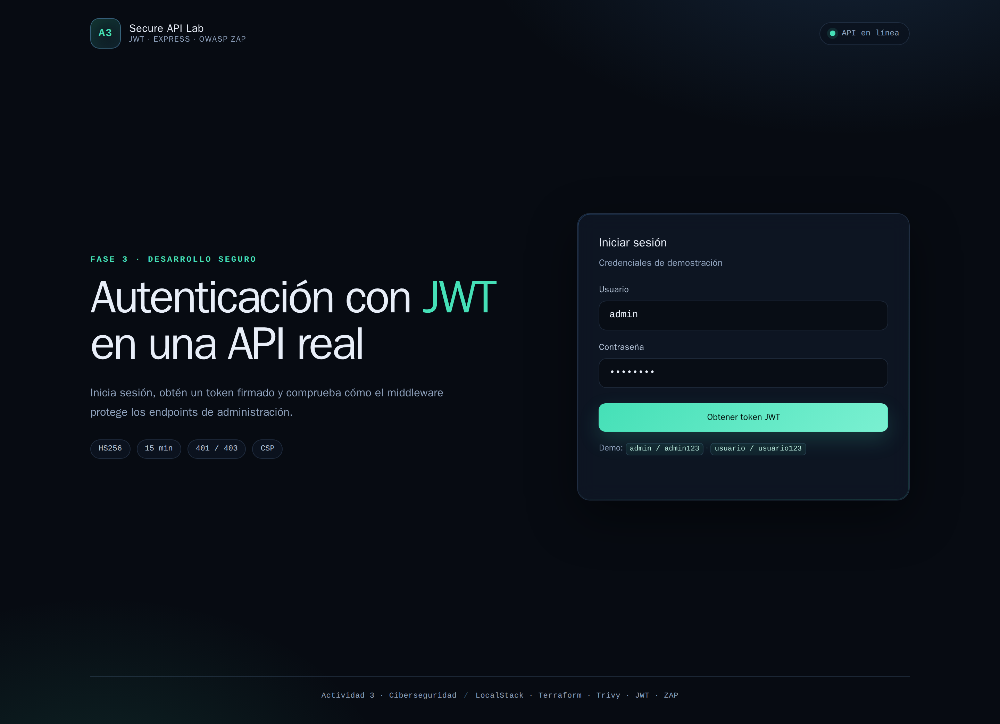
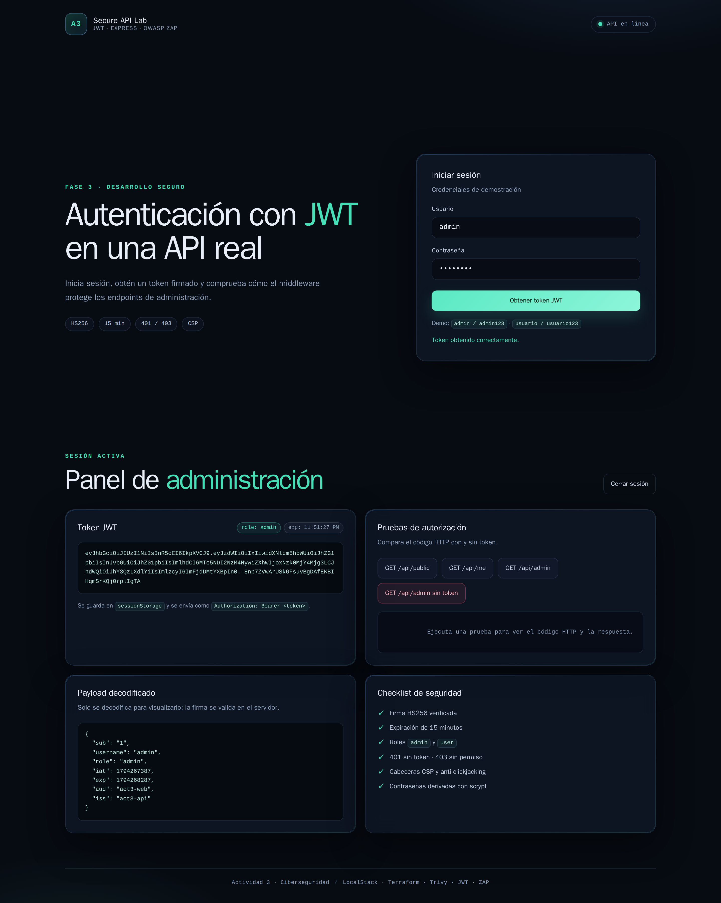

# Fase 3 · API y sitio con autenticación JWT


Sitio web + API con login, token JWT firmado, middleware de autenticación y autorización por rol.

## Demo visual




## Credenciales de demostración

| Usuario | Contraseña | Rol |
|---|---|---|
| `admin` | `admin123` | `admin` |
| `usuario` | `usuario123` | `user` |

## Endpoints

| Método | Ruta | Protección | Resultado esperado |
|---|---|---|---|
| `POST` | `/api/login` | Pública | `200` + token JWT |
| `GET` | `/api/public` | Pública | `200` |
| `GET` | `/api/me` | Token válido | `200` |
| `GET` | `/api/admin` | Token + rol `admin` | `200` |
| `GET` | `/api/admin` | Sin token | `401` |
| `GET` | `/api/admin` | Token inválido | `401` |
| `GET` | `/api/admin` | Token de `user` | `403` |

## Matriz de pruebas

| Prueba | Código | Evidencia |
|---|---:|---|
| Sin token | `401` | `evidencias/pruebas-basicas.txt` |
| Token inválido | `401` | `evidencias/pruebas-autorizacion.txt` |
| Token de usuario sin rol admin | `403` | `evidencias/pruebas-autorizacion.txt` |
| Token de administrador | `200` | `evidencias/pruebas-autorizacion.txt` |

## Middleware JWT

```js
function authenticate(req, res, next) {
  const authHeader = req.headers.authorization;

  if (!authHeader || !authHeader.startsWith('Bearer ')) {
    return res.status(401).json({ error: 'Token requerido' });
  }

  const token = authHeader.slice(7).trim();

  try {
    req.user = jwt.verify(token, JWT_SECRET, {
      algorithms: ['HS256'],
      issuer: 'act3-api',
      audience: 'act3-web'
    });
    return next();
  } catch (error) {
    return res.status(401).json({ error: 'Token inválido o expirado' });
  }
}
```

## Ejecución

```bash
cp .env.example .env
# edita .env y define un JWT_SECRET largo y aleatorio
npm install
npm start
# abre http://localhost:3000
```

## OWASP ZAP

```bash
docker run --rm --network host \
  -v "$PWD/evidencias:/zap/wrk:rw" \
  -t ghcr.io/zaproxy/zaproxy:stable \
  zap-baseline.py -t http://localhost:3000 \
  -r zap-baseline.html -J zap-baseline.json -w zap-baseline.md
```

| Resultado | Cantidad |
|---|---:|
| FAIL | **0** |
| WARN | 3 |
| PASS | 65 |

Las advertencias son de bajo riesgo: contenido no almacenable, formulario de login detectado (esperado) y ausencia de token anti-CSRF. La API usa `Authorization: Bearer` y JSON, por lo que el riesgo CSRF es bajo; aun así, se documenta como mejora.

## Política IAM

Archivo: [`iam-policy.json`](iam-policy.json)

```json
{
  "Version": "2012-10-17",
  "Statement": [
    {
      "Effect": "Allow",
      "Action": ["s3:GetObject"],
      "Resource": "arn:aws:s3:::actividad3-seguro-local/*"
    },
    {
      "Effect": "Allow",
      "Action": ["s3:ListBucket"],
      "Resource": "arn:aws:s3:::actividad3-seguro-local"
    }
  ]
}
```

Aplica mínimo privilegio: solo lectura del bucket de la actividad, sin escritura ni borrado.

## Notas de seguridad

- Contraseñas derivadas con `scrypt` y comparación con `timingSafeEqual`.
- Token con expiración de 15 minutos, `issuer`, `audience` y algoritmo fijado a `HS256`.
- Cabeceras CSP, anti-clickjacking, `nosniff`, COOP/COEP/CORP.
- Límite de intentos de login por IP.
- `JWT_SECRET` fuera del código, en `.env` (ignorado por Git).
